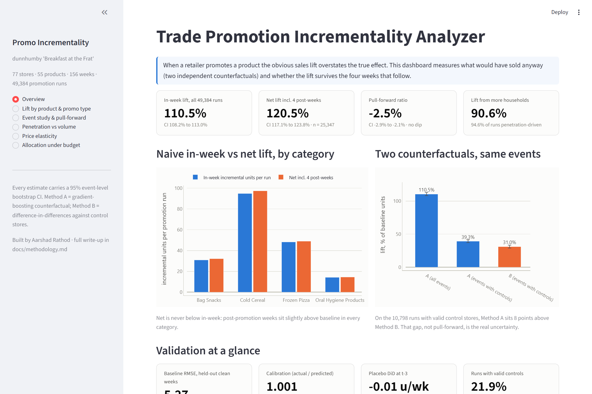
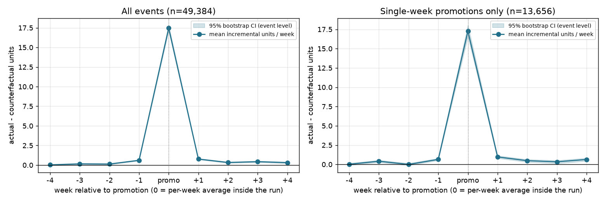
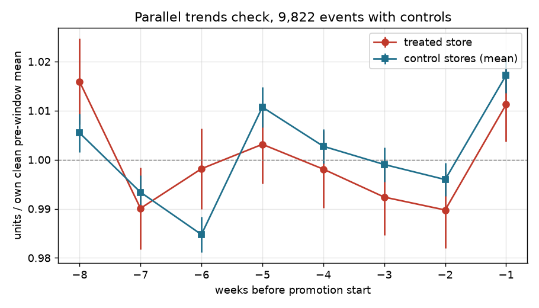

# Trade Promotion Incrementality Analyzer

When a retailer promotes a product, the obvious sales lift overstates the true incremental effect, because some of those sales would have happened anyway and some might be pulled forward from future weeks. This project quantifies both on dunnhumby's "Breakfast at the Frat" scanner data (77 stores, 55 products, 156 weeks) with two independent counterfactuals, event-level bootstrap CIs, placebo and parallel-trends checks, and then stress-tests the number.

**Headline findings.** Promoted weeks sell 2.1x their counterfactual (in-week lift 110%, CI 108 to 113). The feared pantry-loading dip is *not* there: post-promotion weeks sit 2.5% above baseline (CI -2.9 to -2.1 on the pull-forward ratio), because 91% of the lift comes from more households buying rather than existing buyers stocking up. The correction that does matter is methodological: on the same events, the ML baseline gives 39% lift and difference-in-differences gives 31%, and chain-wide feature events lift 5x more than store-level price cuts.

Full write-up: [docs/methodology.md](docs/methodology.md). Daily decisions and what I overrode: [docs/decision_log.md](docs/decision_log.md).

## Dashboard

Six-page interactive Streamlit dashboard (Plotly): overview, lift by product and promo type, event study and pull-forward, penetration vs volume, price elasticity, and allocation under budget with a live integer-program re-solve.







## Run it

```bash
python -m venv .venv
.venv\Scripts\activate            # Windows; on macOS/Linux: source .venv/bin/activate
pip install -r requirements.txt
```

Download `dunnhumby_Breakfast-at-the-Frat.zip` from [dunnhumby.com/source-files](https://www.dunnhumby.com/source-files/) and extract it so the xlsx sits at `data/raw/extracted/dunnhumby_Breakfast-at-the-Frat/`. Then, in order:

```bash
python scripts/00_profile_raw.py          # read the actual workbook, print everything
python scripts/01_phase0_questions.py     # promo share, chain-wide vs store-specific, seasonality
python scripts/02_phase0_sql.py           # SQLite + window-function aggregations
python scripts/10_phase1.py               # ML baseline, DiD, placebo, bootstrap CIs
python scripts/20_phase2.py               # pull-forward, promo types (Welch + BH), penetration vs volume
python scripts/30_phase3_elasticity.py    # own-price elasticity per product
python scripts/40_phase4_allocation.py    # integer-program allocation under budget
python scripts/50_validation.py           # hand-check one event, deliberately break it
streamlit run app/streamlit_app.py
```

Phase 1 takes a few minutes; everything else under a minute. Results land in `outputs/` as markdown, CSV, JSON and PNG.

## Folder map

```
data/raw/            downloaded files, never edited (git-ignored)
data/processed/      clean.parquet, promo.db (SQLite), predictions.parquet, events*.parquet
src/load.py          raw -> clean store x product x week table, promotion definition
src/baseline.py      Method A: gradient-boosting counterfactual on clean non-promo weeks
src/panel.py         dense store x product x week arrays, event (run) table
src/did.py           Method B: difference-in-differences, parallel trends, placebo
src/bootstrap.py     event-level bootstrap CIs
src/metrics.py       pull-forward, event study, Welch/BH tests, log-lift decomposition
src/allocation.py    PuLP integer program for allocation under budget
scripts/             one runnable script per phase (see above)
sql/                 the SQL used in Phase 0
notebooks/           thin notebooks that run each phase script
app/streamlit_app.py four-tab demo
outputs/             generated results and figures
docs/                methodology note and decision log
```

## Stack

Python, pandas, scikit-learn (HistGradientBoostingRegressor), statsmodels, scipy, SQLite (window functions), PuLP/CBC, Streamlit, matplotlib.
